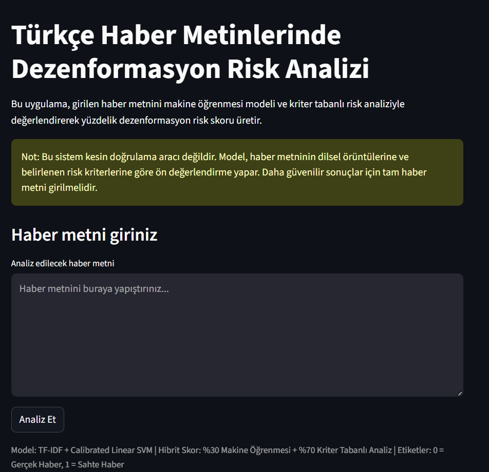
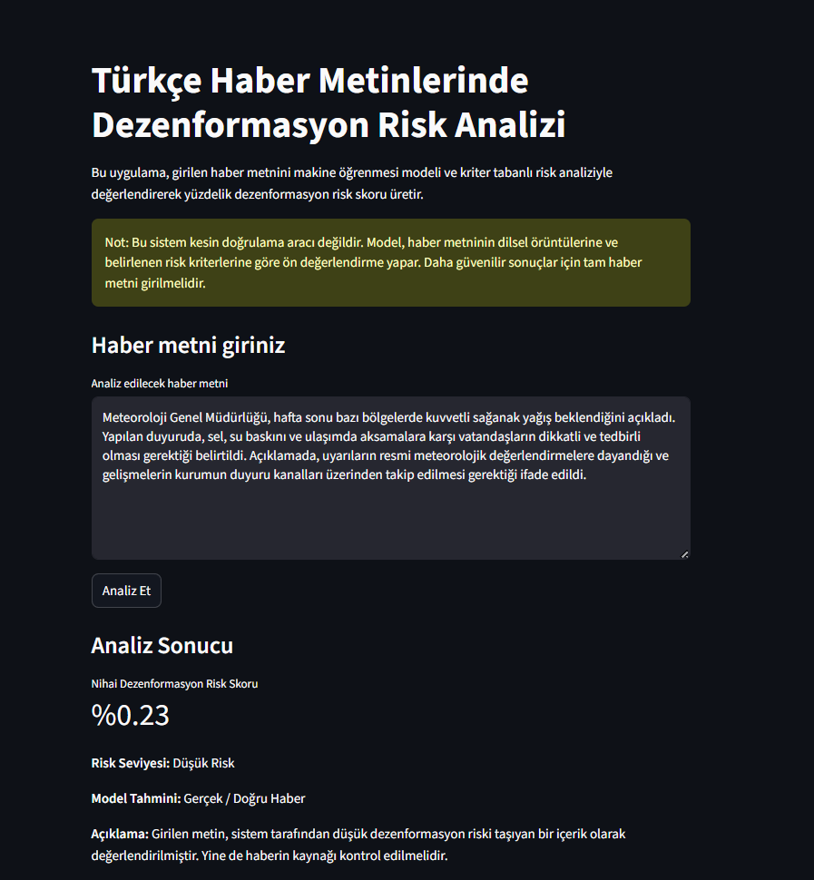
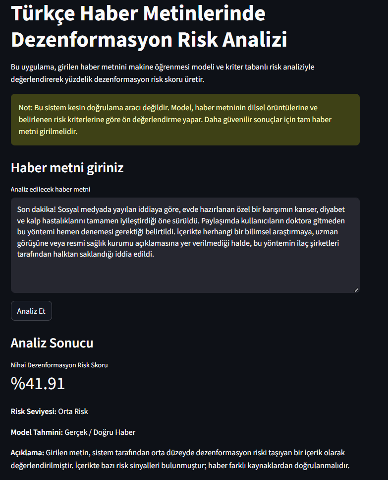
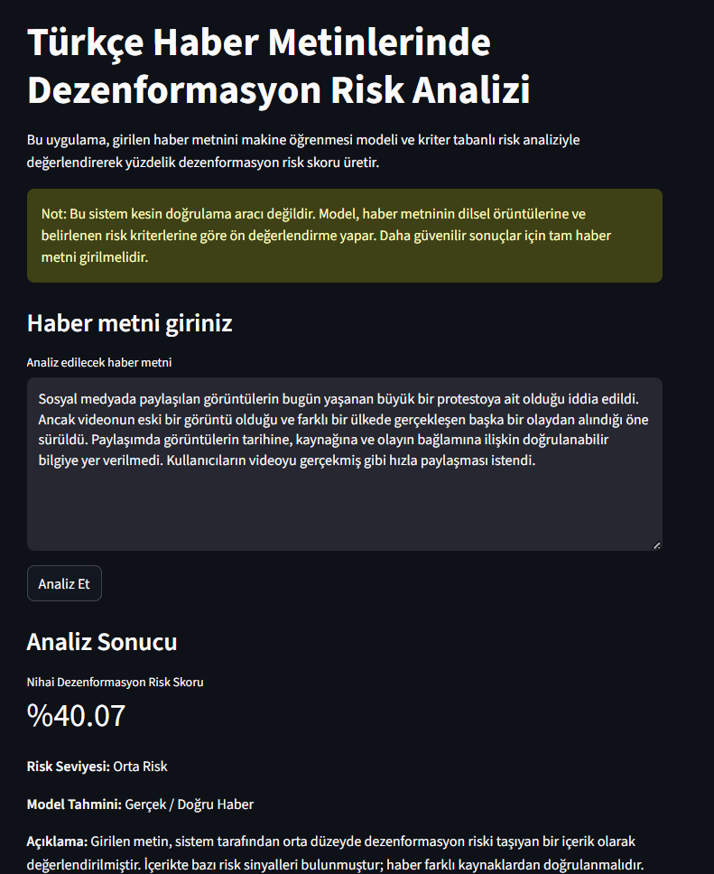
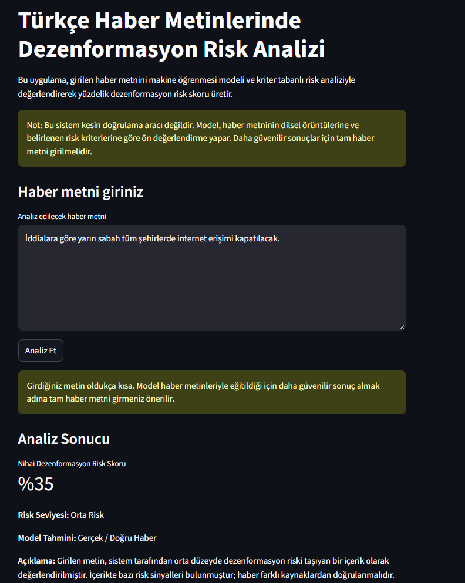

# Turkish News Misinformation Risk Analysis

**Undergraduate capstone project — Sakarya University, Management Information Systems (2026)**  
**Author:** Orhan Akengin  
**Stack:** Python · TF-IDF · Calibrated Linear SVM · Streamlit

A Turkish-language news-text **preliminary misinformation risk assessment** application. It combines a calibrated machine-learning classifier with a four-criterion rule-based layer, then presents a percentage risk score and an explanation of matching risk indicators. **It does not verify factual truth and is not a fact-checking service.**



## What the project does

1. Accepts a Turkish news passage in a Streamlit interface.
2. Uses a TF-IDF vectorizer and a calibrated Linear SVM to estimate closeness to the *fake/satirical news* class learned from training data.
3. Checks for four textual criteria: **missing source**, **inflammatory language**, **emotional exaggeration**, and **misleading context**.
4. Combines the model and weighted rule-based scores, displaying the result on a **0–100** risk scale, associated risk level, and matching phrases.
5. Applies an additional **minimum 35% final-risk rule** for certain short, high-impact claims.

The criteria weights were estimated from 67 valid survey responses (out of 83) using a **BWM-inspired best/worst ranking approach**, **not** the full classical BWM optimization procedure.

**Final score (baseline):**

`0.30 × machine-learning score + 0.70 × criteria-based score`

Risk bands used by `src/app.py`: **low <30; medium 30–<60; high ≥60**. The separate short/high-impact check may raise the final score to at least 35.

## Dataset and reported evaluation

| Item | Value |
|---|---:|
| Main dataset, after cleaning | **4,451** Turkish news texts |
| Training / test split | **3,560 / 891** texts |
| TF-IDF features | **10,000** |
| Calibrated Linear SVM test accuracy | **98.77%** |
| Test precision / recall / F1 | **98.84% / 98.61% / 98.73%** |

These are **held-out results on the project's main dataset**, not an independently established accuracy rate for arbitrary real-world news. Source dataset labels include fake/satirical news. An additional dataset of 3,513 cleaned rows was prepared separately but **not used** for the reported final classifier evaluation. See [Model and evaluation notes](docs/MODEL_AND_LIMITATIONS.md).

## Application screenshots (original project captures)

| Official-style meteorological report (low risk) | Unsupported health claim (medium risk) |
|---|---|
|  |  |
| **0.23%** final risk | **41.91%** final risk |

| Misleading-context example (medium risk) | Short high-impact claim (medium risk) |
|---|---|
|  |  |
| **40.07%** final risk | **35.00%** final risk |

For the full score breakdowns and the original-to-English screenshot filename mapping, see [Screenshot index](docs/SCREENSHOTS.md).

> **Screenshot version note:** These captures were taken from the original application presentation. Their UI labels differ slightly from the current source snapshot's UI labels. The four numerical results have been reproduced from the model and scoring functions included here. The screenshots have **not been edited or reconstructed**.

## Run the existing application

**Do not open untrusted pickle (`.pkl`) models.** Only load model artifacts from a source you trust.

The original project's environment used Python **3.14** and the dependency versions listed in `requirements.txt`. Starting with Python 3.14 is recommended for closer compatibility with the saved model artifacts. The package installation and live Streamlit browser display have not been validated independently for every platform.

```bash
python -m venv .venv
# Windows PowerShell:
.venv\Scripts\Activate.ps1
# macOS / Linux: source .venv/bin/activate
python -m pip install -r requirements.txt
python -m streamlit run src/app.py
```

On Windows, use `py -3.14 -m venv .venv` if you have Python 3.14 installed. The packaged **calibrated model and TF-IDF vectorizer** are sufficient to run the app: the original raw dataset is not needed for inference.

### Verify sample scores

After installing the requirements:

```bash
python -m unittest discover -s tests -v
```

The tests assert the four saved screenshot examples' final scores using the original packaged application functions. See [Validation notes](docs/VALIDATION.md).

## Research / training scripts

The `src/` folder contains **unaltered original code** from the user's supplied `tez.zip`:

| Script | Purpose |
|---|---|
| `01_veri_hazirlama.py` | Prepare and label the main and additional news datasets |
| `02_model_egitimi.py` | Compare Logistic Regression, Naive Bayes, Linear SVM, and Random Forest |
| `03_risk_skoru_test.py` | Earlier Logistic Regression risk-scoring experiment; **not used by the Streamlit app** |
| `04_kalibre_svm_risk_modeli.py` | Train the calibrated Linear SVM and vectorizer |
| `05_anket_bwm_analizi.py` | Analyze survey responses and compute normalized weights |
| `app.py` | Run the interactive risk-analysis interface |

Raw training datasets and individual survey responses are **not** included in this public-ready package. The scripts for preparing/training them remain available but require the original source data. **Known filename mismatch:** `01_veri_hazirlama.py` expects lowercase `data/fake.csv` and `data/real.csv`; the original archive contained uppercase `Fake.csv` and `Real.csv`. When using source datasets, place copies under the expected lowercase filenames (especially on Linux/macOS). See [Data reproduction notes](docs/DATA_REPRODUCTION.md).

## Project structure

```text
.
├── src/           # Original Python source, byte-for-byte preserved
├── models/        # Only the calibrated model and its TF-IDF vectorizer
├── outputs/       # Final non-personal aggregate evaluation results
├── screenshots/   # 13 unmodified captures, with consistent English filenames
├── tests/         # Reproduction checks for four captured examples
├── docs/          # Model notes, data reproduction, provenance and checks
├── data/          # Intentionally empty: raw source data not publicly redistributed
├── requirements.txt
└── README.md
```

## Limitations and responsible use

- This tool reports **language-pattern-based signals and a model score**, **not the truth** of a news story.
- Lexical criteria are heuristics. Repeated or overlapping expressions can raise a criterion's score more than expected.
- Training labels and dataset-specific patterns may limit generalization to unseen news sources and current events.
- Survey-derived weights reflect respondents' preferences, not a representative expert consensus.
- The calibrated percentage is **not** a validated probability that a particular real-world news story is false.
- The interface screenshots and packaged app source reflect different presentation revisions; use the scores as reproducible examples, not pixel-identical UI tests.

See [full limitations](docs/MODEL_AND_LIMITATIONS.md).

## Source and sharing

This repository is a portfolio copy derived from the original 2026 undergraduate capstone project. No raw survey responses, personal information from the thesis front matter, local virtual environment, or IDE state is included. Before uploading any new datasets, model artifacts or thesis PDFs, verify their usage rights and remove private information.

**License:** No open-source license is included. Viewing a public repository does not itself grant permission to reuse its contents. The author may choose an explicit license later.